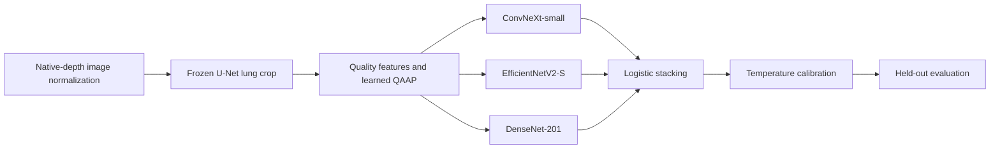
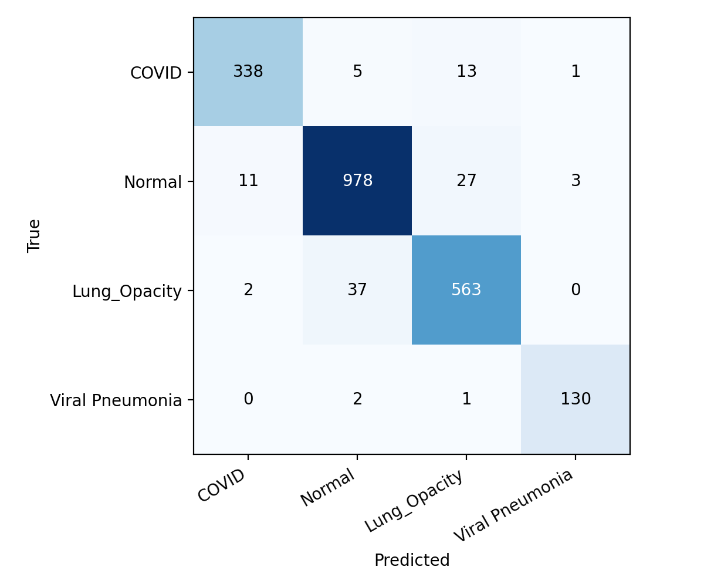

# QAAP: quality-aware pulmonary image classification

A reproducible research pipeline for four-class chest radiograph classification with frozen lung segmentation, trainable quality-aware preprocessing, convolutional classifiers and out-of-fold logistic stacking.

**Completed-run result:** 95.17% accuracy and 95.52% macro-F1 on 2,111 held-out images. Stacking's advantage over soft voting was **not statistically established**. The external experiment measures normal-versus-abnormal transfer to TB-labelled datasets, not a trained TB diagnostic system.

## Start here

- **[Complete notebook](QAAP_Final.ipynb):** all training, recovery, backup and evaluation code, plus clearly labelled archived tables and figures.
- **[Research report](docs/QAAP_final_research_report.pdf):** methodology, equations, component comparisons, results and limitations.
- **[Reproduction guide](docs/REPRODUCIBILITY.md):** Kaggle setup, execution order, recovery and environment details.
- **[Model and data notes](docs/MODEL_CARD.md):** intended use, evaluation boundaries and missing evidence.
- **[Machine-readable results](results/README.md):** aggregate CSV exports from the verified completed run.
- **[Kaggle notebook](https://www.kaggle.com/code/rs1911/qaap-final):** notebook reference supplied by the maintainer; this is not a model-dataset download URL. Access and saved outputs depend on Kaggle permissions.

The notebook was consolidated after the staged experiment. Its executable cells have empty outputs; the archived results appendix is a separate record of the completed run. Viewing those results requires no training or attached dataset. Executing the pipeline requires the original datasets and a CUDA GPU.

## Pipeline



Exact decoded-image duplicates are removed before stratified 70/10/10/10 training, tuning, calibration and test splits. Five folds within the training partition generate held-out predictions for stacking. Each fold fits its own quality normalizers and queue-based momentum-contrast encoder. Separate final models are trained on the full training partition. DeiT-small and three ConvNeXt ablations are evaluated as comparators, outside the ensemble.

## Completed internal results

Accuracy and macro-F1 are percentages. AUC is macro one-versus-rest ROC-AUC. All models use the same test cohort.

| Model | Accuracy | Macro-F1 | AUC |
|---|---:|---:|---:|
| ConvNeXt full | 91.33 | 90.97 | 0.9857 |
| EfficientNetV2-S | 94.03 | 93.64 | 0.9925 |
| DenseNet-201 | 94.22 | 94.31 | 0.9928 |
| DeiT-small | 94.50 | 94.55 | 0.9904 |
| Soft voting | 94.98 | 95.04 | 0.9934 |
| Logistic stacking | **95.17** | **95.52** | 0.9933 |

Stacking macro-F1 has a 95% stratified bootstrap interval of **94.61–96.42%**. Its difference from soft voting is **+0.48 percentage points**, with a paired interval of **−0.12 to +1.15 points**. The Holm-adjusted exact McNemar p-value is **0.481**; that test compares correctness, not macro-F1. Comparisons use 1,000 shared stratified bootstrap replicates from one trained realization.



## What the experiment does and does not support

- **Component findings:** single-scale ConvNeXt achieved 93.29% macro-F1, above the full multi-scale model's 90.97%. Full QAAP versus no QAAP differed by only +0.08 points; the report's exploratory paired interval crosses zero. The results do not establish that every component improves performance.
- **External transfer:** stacking reached 75.29% macro-F1, AUC 0.8470, sensitivity 61.42% and specificity 89.90% on 800 Shenzhen/Montgomery images at a fixed abnormality threshold of 0.5. Single-scale ConvNeXt had the strongest pooled external point estimates. Internal and external F1 values describe different tasks.
- **Calibration:** stacking test ECE was 0.0133 after scaling versus approximately 0.0125 before. Calibration did not improve every test confidence measure.
- **Latency:** measured single-GPU batch-one p95 was **112.53 ms**. The 100 ms target was not met.
- **Speed:** sparse QAAP was about 10.46 times faster in the recorded synthetic preprocessing forward/backward benchmark. This is not a measured end-to-end training speedup. Logged training segments sum to about 3.61 hours and exclude preprocessing, evaluation, interruptions and session overhead.
- **Data limits:** splits are image-level, not verified patient-level splits. Exact deduplication does not remove every near-duplicate. Manufacturer metadata was unavailable for all 800 external images. Grad-CAM explains selected DenseNet examples, not the ensemble.

## Run on Kaggle

1. Import [QAAP_Final.ipynb](QAAP_Final.ipynb) into a Kaggle notebook.
2. Enable a T4 accelerator and Internet. The implementation intentionally uses **one GPU**, even when two T4s are visible.
3. Attach the original [COVID-19 Radiography Database](https://www.kaggle.com/datasets/tawsifurrahman/covid19-radiography-database), Shenzhen and Montgomery collections, including the metadata expected by the loader. See [data availability](docs/REPRODUCIBILITY.md#data-and-model-availability).
4. For fresh training, leave `RESTORE_COMPLETED_RUN = False`. Run cells sequentially through setup, the five folds, seven final models, and evaluation. **Do not use Run All:** pause to download each stage backup.
5. Download every backup part and its manifest. [verify_stage_backups.py](tools/verify_stage_backups.py) verifies sizes and SHA-256 hashes and can join parts into ordinary ZIPs. Save the executed notebook separately before ending the session.

The training schedule retains all data, five folds, one SSL epoch and five supervised epochs per classifier: six SSL runs and 22 classifier runs. The implementation uses global batch 32, mixed precision, bounded packed-image reads, zero loader workers and cuDNN autotuning off.

## Repository contents

```text
QAAP_Final.ipynb             Complete implementation and archived results
docs/                       Research report, reproduction guide and model card
results/                    Aggregate metrics, recorded environment and two figures
tools/verify_stage_backups.py Download verification and split-ZIP reconstruction
requirements.txt            Notebook dependencies; not a full environment lock
CITATION.cff                Citation metadata for this software repository
```

Large model archives and source images are not committed here. A public download URL for the completed weights has not been supplied in the repository; reproduction from saved weights requires obtaining `QAAP_complete_run.zip` from the maintainer. Training from source remains possible with the original datasets. Do not assume a private Kaggle input is accessible to reviewers.

## Citation and provenance

Use [CITATION.cff](CITATION.cff) to cite the software. The attached document is a **research report**, not a claim of peer-reviewed publication or an assigned DOI. Architectural and dataset references are listed in the report, including U-Net/GenSeg, ConvNeXt, MoCo, CBAM, EfficientNetV2, DenseNet, DeiT, temperature scaling and Grad-CAM.

No project-wide software license has been selected. Do not assume an open-source license from public repository visibility; third-party datasets, pretrained weights and borrowed implementations retain their own terms. Research use only; clinical validity has not been established.
